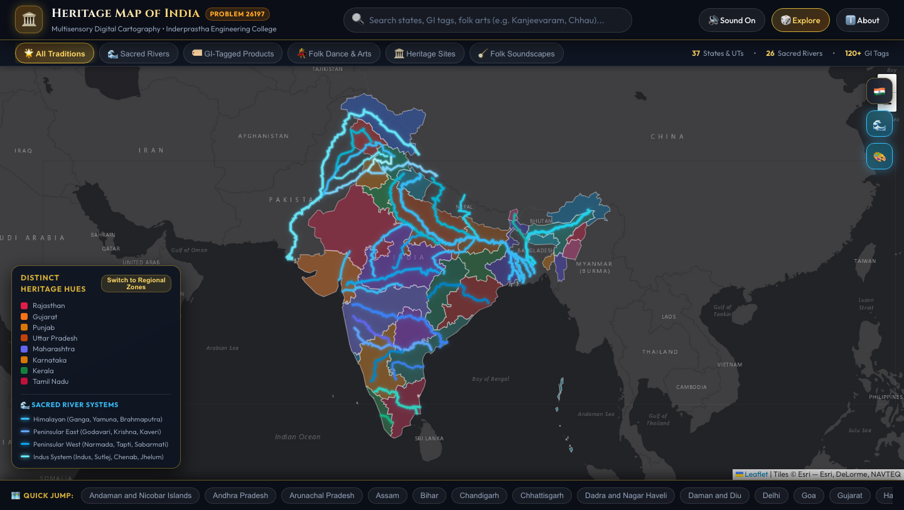
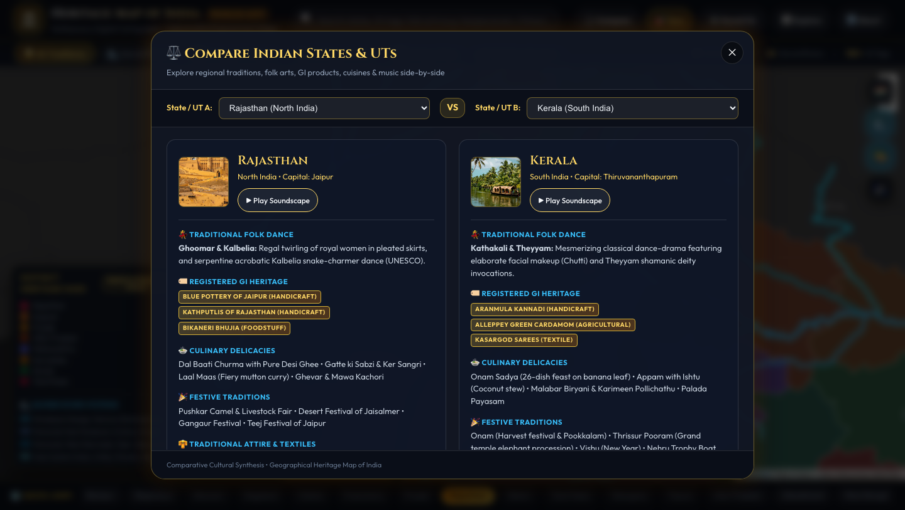
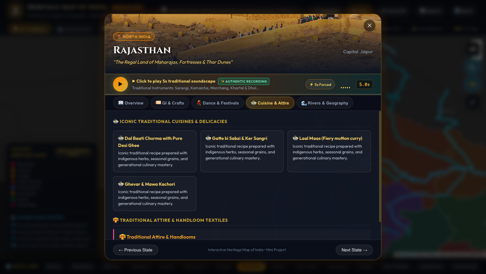
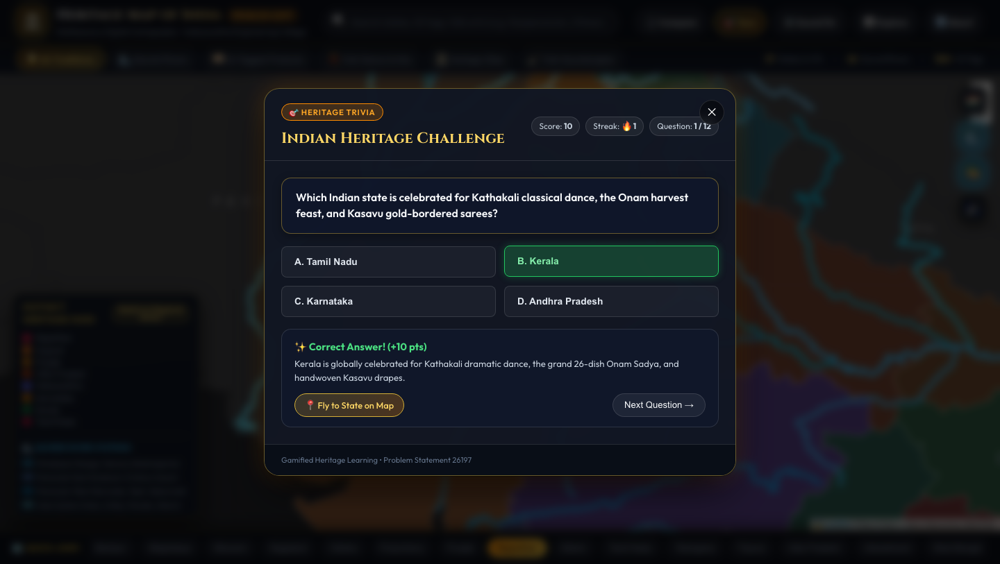
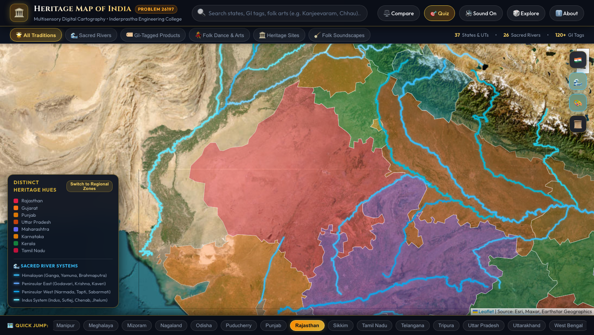
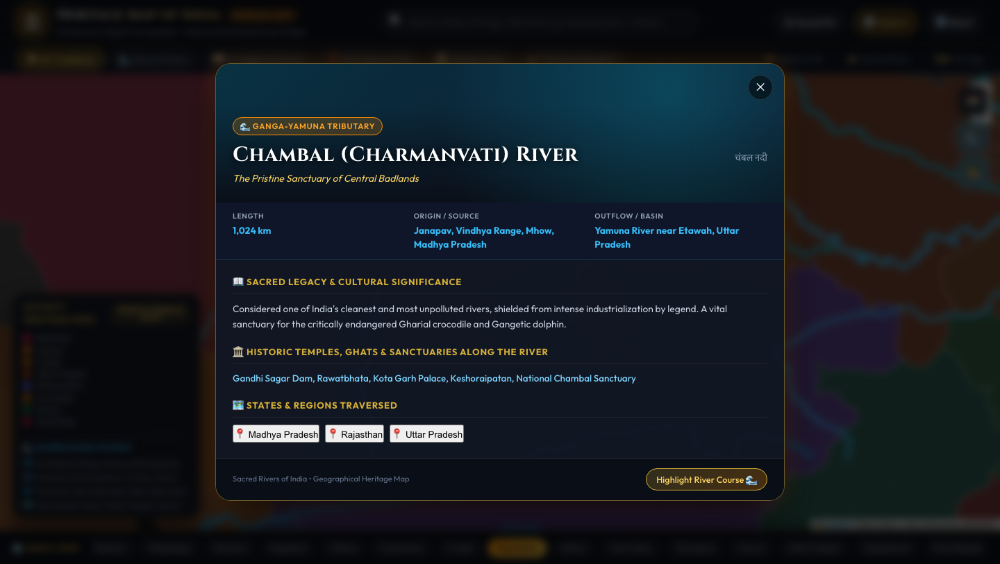
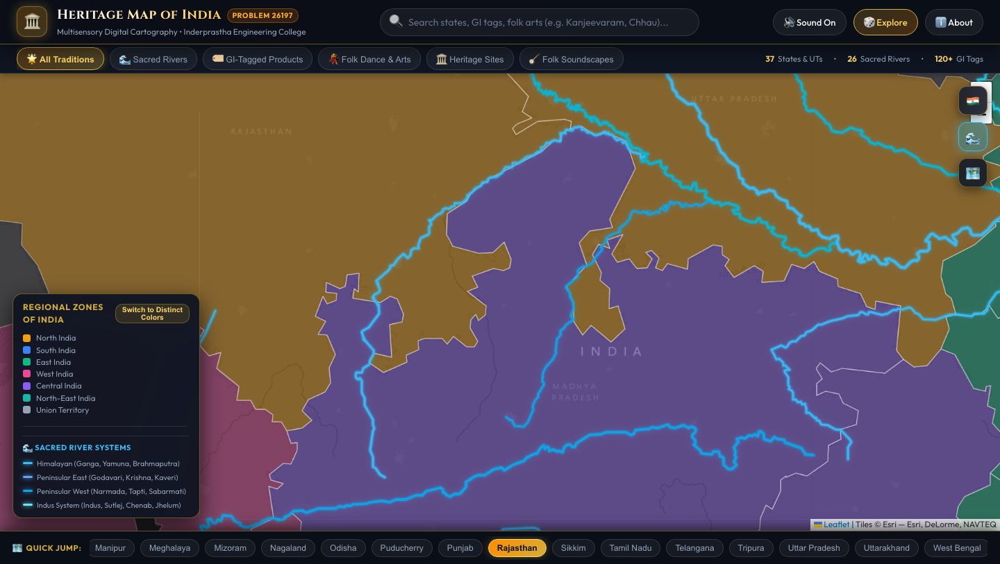

# Interactive Geographical Heritage Map of India 🇮🇳

[](https://mini-project-heritage-map-of-india.vercel.app/)
[](https://github.com/Manya-Goel132/Mini-Project-Heritage-Map-of-India)
[](https://opensource.org/licenses/MIT)
[](https://github.com/Manya-Goel132/Mini-Project-Heritage-Map-of-India)

> **College Mini-Project | Problem Statement 26197: Innovative ideas showcasing Indian traditions**  
> 🌐 **Live Web Application:** [https://mini-project-heritage-map-of-india.vercel.app](https://mini-project-heritage-map-of-india.vercel.app/)  
> 📁 **GitHub Repository:** [https://github.com/Manya-Goel132/Mini-Project-Heritage-Map-of-India](https://github.com/Manya-Goel132/Mini-Project-Heritage-Map-of-India)  
> **Student:** Manya Goel (University Roll No: `2400300100237`)  
> **Faculty Guide:** Ms. Disha  
> **Institution:** Inderprastha Engineering College (IPEC), Ghaziabad  
> **Affiliation:** Dr. A.P.J. Abdul Kalam Technical University (AKTU)

---

## 📖 Executive Summary & Abstract

Traditional educational media and static textbooks often reduce India's multi-millennial cultural legacy into detached, flat historical facts. They fail to evoke the living, spatial, and multisensory reality of Indian traditions.

The **Interactive Geographical Heritage Map of India** is a responsive, web-based digital cartography platform that bridges centuries of traditional heritage with modern front-end web engineering. By combining high-precision vector GIS polygons with an authentic regional soundscape engine, interactive Geographical Indication (GI) product registries, and traditional folk dance archives, this platform offers students, researchers, and cultural enthusiasts an intuitive, multisensory journey across all **37 States and Union Territories** of India.

---

## ⚡ Exact Technology Stack

In strict accordance with the project abstract and presentation specifications (PPT Slide 5):

| Layer | Technology | Implementation Details |
| :--- | :--- | :--- |
| **Markup & Semantics** | **HTML5** | Semantic, accessible DOM structure (`header`, `main`, `nav`, `footer`, ARIA roles). |
| **Styling & Aesthetics** | **CSS3 (Vanilla)** | Glassmorphism, CSS Custom Properties (Design Tokens), responsive Flexbox viewport architecture, smooth transitions. Zero heavy CSS frameworks. |
| **Logic & Interactivity** | **Vanilla JavaScript (ES6+)** | State management, joint state & river search indexing, event delegation, audio synthesis, and modal lifecycle. |
| **Cartography & GIS** | **Leaflet.js (v1.9.4)** | Client-side interactive tile rendering, vector polygon GeoJSON layer parsing, vector centerline river rendering, dynamic hover/click boundaries. |
| **Spatial Datasets** | **GeoJSON (`india_states.geojson` & `india_rivers.geojson`)** | Comprehensive spatial coordinates for all 37 Indian States and Union Territories + 35+ high-precision major river centerlines and basins. |
| **Audio Subsystem** | **HTML5 Audio API** | Real field recordings, custom playback controller, **Forced Short-Play (5-second snippet engine)** with audio cue offsets and smooth volume fade-out. |
| **Basemap Provider** | **Esri World Dark Gray Canvas** | Free, high-contrast dark cartography with zero watermarks and zero external API key requirements. |

---

## 🌟 Core Features & System Capabilities

### 1. Distinct State Color Cartography & Dual-Mode Visualization
- **Curated Palette for All 37 States & UTs:** Every individual state and union territory features a custom-curated, vibrant heritage color (e.g. Royal Rajputana Crimson for Rajasthan, Marigold Sunset Orange for Gujarat, Shivaji Indigo for Maharashtra, Dravidian Ruby for Tamil Nadu, God's Own Viridian for Kerala).
- **Dual Coloring Modes:** Toggle effortlessly between **🎨 Distinct State Hues** and **🗺️ Regional Zones** (North, South, East, West, Central, North-East, and UTs) via the floating map toolbar or the dynamic legend.
- **Dynamic Floating Legend:** Color-coded reference card that updates in real-time between Distinct and Regional views, adapting cleanly across desktop and mobile.

### 2. Deep State Heritage Exploration (5-Tab Drawer Architecture)
- **📖 Overview Tab:** In-depth cultural legacy narrative, capital city, official spoken regional languages, indigenous heritage musical instruments, and UNESCO World Heritage Monuments & Architecture.
- **🏷️ GI & Crafts Tab:** Full catalog of certified Geographical Indication (GI) products with official classification badges (*Handicrafts, Textiles, Agricultural, Foodstuff*) alongside traditional handicraft legacy descriptions.
- **💃 Dance & Festivals Tab:** Classical and regional folk dance forms with historical context, alongside major traditional harvest, seasonal, and spiritual festivals.
- **🍲 Cuisine & Attire Tab:** Iconic state culinary delicacies and traditional recipes paired with authentic traditional attire, ceremonial costumes, and handloom textiles.
- **🌊 Rivers & Geography Tab:** Geographic landscape summary, prominent mountain ranges/forests/deserts, and interactive passing river badges linking directly to river profiles.

### 3. Dual State Cultural Comparison Engine (⚖️ Compare)
- **Side-by-Side Cultural Synthesis:** Compare any two Indian States or Union Territories simultaneously across all major cultural dimensions.
- **Dual Soundscape Triggers:** Listen to both states' traditional acoustic recordings side-by-side to appreciate diverse regional soundscapes.
- **Comparative Metrics:** Instant comparison of capital, folk dances, registered GI tags, culinary masterpieces, festive traditions, and handloom textiles.

### 4. Gamified Indian Heritage Trivia Challenge (🎯 Quiz)
- **Dynamic Interactive Learning:** 12-question randomized trivia challenge spanning sacred rivers, GI tag origins, traditional dance forms, and culinary arts.
- **Streak & Scoring HUD:** Tracks live score, correct answer streaks (`🔥`), and progress.
- **Instant Explanations & Map Fly-To:** Interactive feedback reveals the historical context of each answer, with a one-click **"📍 Fly to State on Map"** button that automatically navigates the camera to the state.

### 5. Multi-Style Basemap Switcher (🛰️)
- **Midnight Dark Canvas:** High-contrast dark cartography optimized for glowing river centerlines and vivid state polygons (Esri Dark Gray).
- **Satellite Topography:** Ultra-high-resolution real-world satellite imagery showing actual mountain ranges, river valleys, and coastlines (Esri World Imagery).
- **Warm Heritage Terrain:** Clean, elegant soft-terrain cartography for daytime reading and geographical context (Carto Voyager).

### 6. Sacred Rivers of India (Hydrological Lifelines)
- **35+ Major Centerlines & Basins:** Features high-precision vector centerlines with luminescent multi-layer glowing effects for major rivers: Ganga, Yamuna, Brahmaputra, Indus, Godavari, Krishna, Kaveri, Narmada, Tapti, Mahanadi, Sutlej, Chenab, Jhelum, Ravi, Beas, Chambal, Tungabhadra, Teesta, Betwa, Son, Ghaghara, Gandak, Penna, Sabarmati, and Periyar.
- **Interactive River Details Modal:** Click any river to inspect its Devanagari name, river system, official length, glacial/mountain origin, discharge basin, traversed states, historic ghats/monuments, and cultural/spiritual significance.
- **Two-Way State-River Connectivity:** State cards display passing rivers as interactive pills; River cards display traversed states as interactive chips for seamless exploration.
- **River Focus Mode:** Click "Highlight River Course" to automatically center and zoom the camera onto the river's entire basin.

### 7. Multisensory 5-Second Traditional Soundscape Engine (PPT Slide 4)
- **Authentic Field & Studio Recordings:** Incorporates 17 verified traditional recordings sourced from the **Centre for Cultural Resources and Training (CCRT, Ministry of Culture, Govt. of India)**, **ICCR**, and **Wikimedia Commons** (e.g., Punjab Dhol & Algoze, Rajasthan Kamaicha & Khartal, Maharashtra Lavani Dholki, Kashmir Santoor & Rabab, Assam Bihu Pepa, Ladakh Tibetan Dungchen, Carnatic Flute & Veena).
- **Client-Side Forced Short-Play:** 
  - Complete, uncompressed audio tracks are preserved on disk.
  - An intelligent client-side playback controller starts playback at the musically rich section (`audioStartOffset`), tracks a live 5.0-second countdown, applies a smooth exponential volume fade in the final 800ms, and terminates playback precisely at 5.0 seconds.
  - Includes a user toggle between **⚡ 5s Forced Snippet** and **🎵 Full Track** mode.
- **Visual Equalizer Wave:** Real-time animated CSS sound equalizer and interactive progress bar indicating exact snippet duration.

### 8. Interactive Navigation & Exploration Tools
- **Joint State & River Autocomplete Search:** Real-time query filtering across states, capital cities, GI products, dance forms, and river systems with custom-badged suggestion items.
- **Layer Category Filters:** Switch views between *All Traditions*, *Sacred Rivers*, *GI-Tagged Products*, *Folk Dance & Arts*, *Heritage Sites*, and *Folk Soundscapes*.
- **Quick-Jump State Carousel:** Bottom carousel bar displaying instant-navigation chips for all states and UTs.
- **Random State Explorer (🎲 Explore):** One-click discovery mode that pans the map and opens the heritage card for an unexplored Indian state.

### 9. Zoom-Resilient Responsive Architecture
- Rigid flex-column viewport architecture (`height: 100dvh`, zero window scrollbars) preventing layout shifts, overlap, or clipping.
- Rigorously tested and visually verified in Google Chrome across standard (100%), zoomed-out (67%), zoomed-in (125%), and mobile viewports.

---

## 📸 Visual Showcase & Interface Previews

### 1. Distinct State Colors & Glowing Sacred Rivers Overview (100% Zoom)


### 2. Dual State Cultural Comparison Engine


### 3. State Heritage Drawer (5-Tab Architecture - Cuisine & Attire)


### 4. Interactive Heritage Trivia Challenge


### 5. Satellite Topography Basemap View


### 6. Interactive Sacred River Details Modal


### 7. Regional Zones Mode & Focused River View


---

## 📁 Repository Directory Structure

```text
Interactive-Geographical-Heritage-Map/
│
├── index.html                   # Main entry point and semantic DOM layout
├── README.md                    # Comprehensive project documentation
├── .gitignore                   # Ignored files (system, logs, temp files)
├── Manya_Goel_Mini_Project_PPT.pdf      # Official academic presentation
├── Manya_Goel_Mini_Project_Abstract.pdf # Project synopsis and problem statement
│
├── css/
│   └── styles.css               # Complete design system, glassmorphism, responsive flex
│
├── js/
│   ├── app.js                   # Application controller, Leaflet logic, river engine, audio engine
│   └── stateData.js             # 37 states database (GI tags, dances, audios, summaries)
│
├── data/
│   ├── india_states.geojson     # Vector boundary GeoJSON for all Indian States & UTs
│   └── india_rivers.geojson     # High-precision vector centerlines for 35+ major rivers & basins
│
├── docs/
│   └── screenshots/             # Interface showcase captures
│       ├── overview_desktop.png          # Distinct state colors and glowing river vectors
│       ├── compare_states_view.png       # Dual state cultural comparison engine
│       ├── cuisine_attire_tab_view.png   # 5-tab state heritage drawer (Cuisine & Attire)
│       ├── heritage_quiz_view.png        # Interactive heritage trivia challenge
│       ├── satellite_basemap_view.png    # High-resolution satellite topography basemap
│       ├── river_modal_details.png       # Detailed river heritage modal with metrics and basin
│       ├── state_modal_with_rivers.png   # State modal with passing rivers lifelines
│       └── regional_zones_view.png       # Regional zones dual-view mode
│
├── audio/                       # 55 Complete Regional Folk Audio Tracks
│   │
│   ├── # Authentic Field & Studio Recordings (CCRT, ICCR & Wikimedia)
│   ├── assam_real.mp3           # Bihu dhol, pepa horn & taal
│   ├── bansuri_real.ogg         # Traditional Indian bamboo bansuri
│   ├── carnatic_concert_real.ogg# South Indian classical ensemble (Veena, Flute, Mridangam)
│   ├── gujarat_garba_real.mp3   # Authentic Gujarati garba dhol & shehnai
│   ├── kashmir_santoor_real.mp3 # Kashmiri sufi santoor & rabab
│   ├── kerala_real.ogg          # Sopana sangeetham & chenda melam
│   ├── ladakh_tibetan_real.ogg  # Buddhist monastery dungchen horns & cymbals
│   ├── maharashtra_real.ogg     # Lavani dholki & lejim
│   ├── manipur_real.mp3         # Manipuri pung cholom & pena
│   ├── odisha_real.mp3          # Odissi mardala & flute
│   ├── punjab_real.wav          # Punjab folk dhol & boliyan
│   ├── rajasthan_real.ogg       # Desert folk kamaicha & sarangi
│   ├── tamil_nadu_real.ogg      # Nadaswaram & thavil temple soundscape
│   ├── tribal_folk_real.mp3     # Central Indian mandri & madal drumming
│   ├── uttar_pradesh_real.wav   # Braj Holi folk rasia & harmonium
│   ├── uttarakhand_real.ogg     # Kumaoni & Garhwali dhol-damau
│   ├── west_bengal_real.mp3     # Baul folk ektara & dotara
│   │
│   └── # State & Union Territory Regional Acoustic Soundscapes
│       ├── andaman_and_nicobar_islands.wav
│       ├── andhra_pradesh.wav
│       ├── arunachal_pradesh.wav
│       ├── assam.wav
│       ├── bihar.wav
│       ├── chandigarh.wav
│       ├── chhattisgarh.wav
│       ├── dadra_and_nagar_haveli.wav
│       ├── dadra_and_nagar_haveli_and_daman_and_diu.wav
│       ├── daman_and_diu.wav
│       ├── delhi.wav
│       ├── goa.wav
│       ├── gujarat.wav
│       ├── haryana.wav
│       ├── himachal_pradesh.wav
│       ├── jammu_and_kashmir.wav
│       ├── jharkhand.wav
│       ├── karnataka.wav
│       ├── kerala.wav
│       ├── ladakh.wav
│       ├── lakshadweep.wav
│       ├── madhya_pradesh.wav
│       ├── maharashtra.wav
│       ├── manipur.wav
│       ├── meghalaya.wav
│       ├── mizoram.wav
│       ├── nagaland.wav
│       ├── odisha.wav
│       ├── puducherry.wav
│       ├── punjab.wav
│       ├── rajasthan.wav
│       ├── sikkim.wav
│       ├── tamil_nadu.wav
│       ├── telangana.wav
│       ├── tripura.wav
│       ├── uttar_pradesh.wav
│       ├── uttarakhand.wav
│       └── west_bengal.wav
│
└── vendor/
    └── leaflet/                 # Local Leaflet v1.9.4 distribution (with CDN fallback)
        ├── leaflet.js
        └── leaflet.css
```

---

## 🚀 Live Demo & Local Setup

### 🌐 Live Deployment
The interactive web map is continuously deployed and live on Vercel:  
👉 **[https://mini-project-heritage-map-of-india.vercel.app](https://mini-project-heritage-map-of-india.vercel.app/)**

---

## 💻 Local Setup Guide (First-Time Laptop Setup)

The project is completely self-contained and engineered with vanilla web technologies. It requires **zero build steps, zero compiler dependencies, and zero `npm install` packages**. 

> [!IMPORTANT]
> **Why an HTTP server is required:**  
> The application uses the standard JavaScript `fetch()` API to dynamically load high-precision GeoJSON vector layers (`data/india_states.geojson` and `data/india_rivers.geojson`). Modern web browsers block `fetch()` under the `file:///` protocol due to strict browser CORS (Cross-Origin Resource Sharing) policies.  
> **Always run the project through a lightweight local server (Options A, B, or C below) rather than double-clicking `index.html`.**

---

### Step 1: Get the Code on Your Laptop

Choose either **Method 1 (Git Clone)** or **Method 2 (Downloaded ZIP)**:

#### Method 1: Clone via Git (Recommended)
Open Terminal (macOS/Linux) or Command Prompt / PowerShell (Windows) and run:

```bash
# Standard public clone:
git clone https://github.com/Manya-Goel132/Mini-Project-Heritage-Map-of-India.git

# Enter the project directory:
cd Mini-Project-Heritage-Map-of-India
```

*(Optional: If cloning a private repo or pushing commits with personal access token)*:
```bash
git clone https://<YOUR_GITHUB_TOKEN>@github.com/Manya-Goel132/Mini-Project-Heritage-Map-of-India.git
cd Mini-Project-Heritage-Map-of-India
```

#### Method 2: From a Downloaded ZIP Folder
1. Click the green **Code** button on the [GitHub repository page](https://github.com/Manya-Goel132/Mini-Project-Heritage-Map-of-India) and choose **Download ZIP** (or use the submitted project ZIP).
2. Extract / Unzip the archive:
   - **Windows:** Right-click the `.zip` file → Select **"Extract All..."** → Open the extracted folder.
   - **macOS:** Double-click the `.zip` file in Finder → Open the extracted folder.
   - **Terminal (macOS/Linux):**
     ```bash
     unzip Mini-Project-Heritage-Map-of-India-main.zip
     cd Mini-Project-Heritage-Map-of-India-main
     ```

---

### Step 2: Launch the Local HTTP Server

Run **any one** of the following options inside the project folder:

#### Option A: Python 3 (Easiest & Pre-installed on macOS / Linux / Windows)
Open your terminal inside the project directory and run:

```bash
# macOS / Linux / Windows (Python 3)
python3 -m http.server 8080

# On Windows systems where the command is 'python':
python -m http.server 8080
```

#### Option B: Node.js / npx (Zero package installation needed)
If you have Node.js installed, run:

```bash
npx serve -l 8080 .
# or
npx http-server -p 8080
```

#### Option C: VS Code "Live Server" Extension (No Terminal Needed)
1. Open Visual Studio Code.
2. Select **File → Open Folder...** and choose the `Mini-Project-Heritage-Map-of-India` directory.
3. Install the **"Live Server"** extension (by Ritwick Dey) from the VS Code Extensions tab (`Ctrl+Shift+X` or `Cmd+Shift+X`).
4. Right-click on `index.html` in the file explorer and click **"Open with Live Server"**.
5. Your default browser will automatically open with the project running at `http://127.0.0.1:5500`.

#### Option D: PHP Built-in Server (macOS / Linux)
```bash
php -S localhost:8080
```

---

### Step 3: Open the Platform in Your Web Browser

Open any modern browser (Google Chrome, Mozilla Firefox, Safari, Microsoft Edge, Brave) and navigate to:

```text
http://localhost:8080
```
*(or the port number output by your chosen server above)*

---

### 🛠️ Quick Troubleshooting FAQ

| Problem | Cause | Solution |
| :--- | :--- | :--- |
| **Map shows blank or state outlines don't load** | File was opened directly via `file:///.../index.html` instead of an HTTP server, causing browser CORS security to block `.geojson` fetches. | Run `python3 -m http.server 8080` or use VS Code Live Server as instructed in Step 2 above. |
| **`Address already in use` error** | Another application is already using port `8080`. | Run the server on a different port, e.g.: `python3 -m http.server 8000` or `python3 -m http.server 3000`, then open `http://localhost:8000`. |
| **Audio does not play on first click** | Modern browsers have autoplay restrictions that require at least one user gesture before audio can play. | Click anywhere on the map or click the **"🔊 Sound On"** header button to enable audio playback. |
| **Map controls look small/zoomed** | Browser zoom level is set high/low. | Press `Ctrl + 0` (Windows) or `Cmd + 0` (macOS) to reset your browser zoom to standard 100%. |

---

## 🎨 Cultural Data & Audio Attributions

1. **Audio Recordings:** Sourced under Open Cultural & Creative Commons licenses from:
   - *Centre for Cultural Resources and Training (CCRT)*, Ministry of Culture, Government of India.
   - *Indian Council for Cultural Relations (ICCR)* archives.
   - *Wikimedia Commons Audio Archives* (Traditional Indian Folk Music repositories).
2. **Geographical Indications (GI):** Validated against official records of the *Intellectual Property India (Geographical Indications Registry)* under the Department for Promotion of Industry and Internal Trade (DPIIT), Ministry of Commerce and Industry.
3. **Cartography Basemap:** World Dark Gray Canvas powered by *Esri, DeLorme, NAVTEQ*.
4. **Typography:** *Cinzel* (Serif display for traditional Indian titles) and *Outfit* (Sans-serif for crisp legibility), served via Google Fonts.

---

## 🎓 Academic Attribution

This project is submitted in partial fulfillment of the requirements for the **Mini-Project** curriculum at **Inderprastha Engineering College (IPEC)**, Ghaziabad.

- **Student:** Manya Goel
- **University Roll Number:** `2400300100237`
- **Problem Statement ID:** `26197`
- **Faculty Guide:** Ms. Disha
- **Live Web Application:** [https://mini-project-heritage-map-of-india.vercel.app](https://mini-project-heritage-map-of-india.vercel.app/)
- **GitHub Repository:** [Manya-Goel132/Mini-Project-Heritage-Map-of-India](https://github.com/Manya-Goel132/Mini-Project-Heritage-Map-of-India)

---

## 📄 License

This project is created for educational and academic research purposes under the **MIT License**. All cultural recordings and GI tag logos remain the intellectual and cultural heritage of their respective communities and sovereign government authorities.
